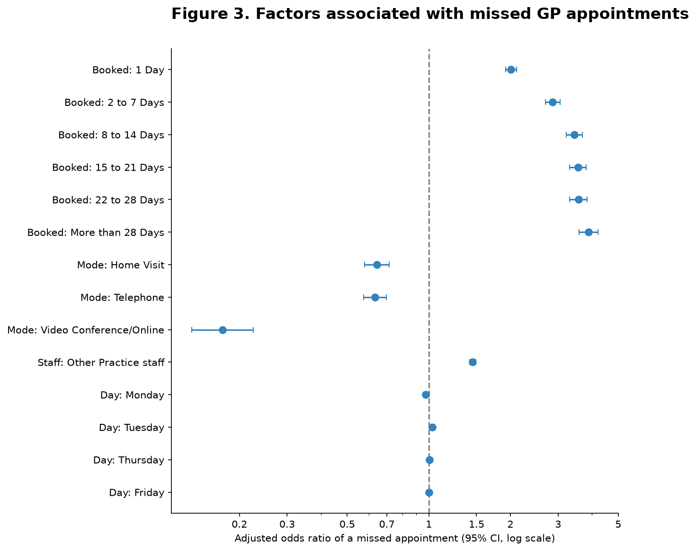
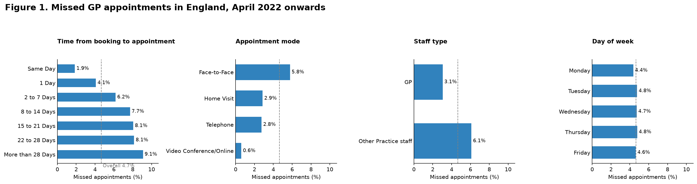
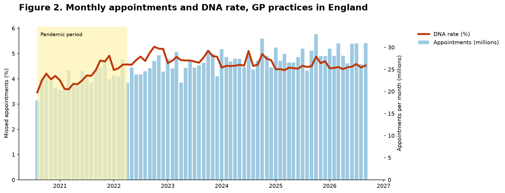
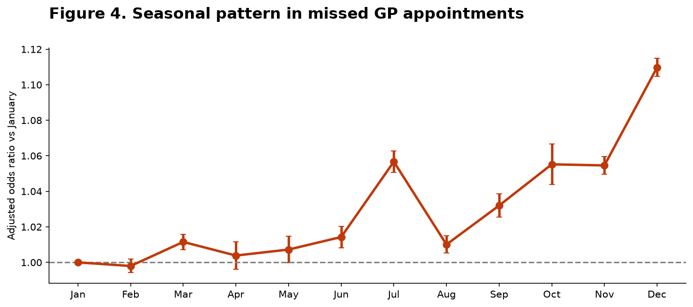
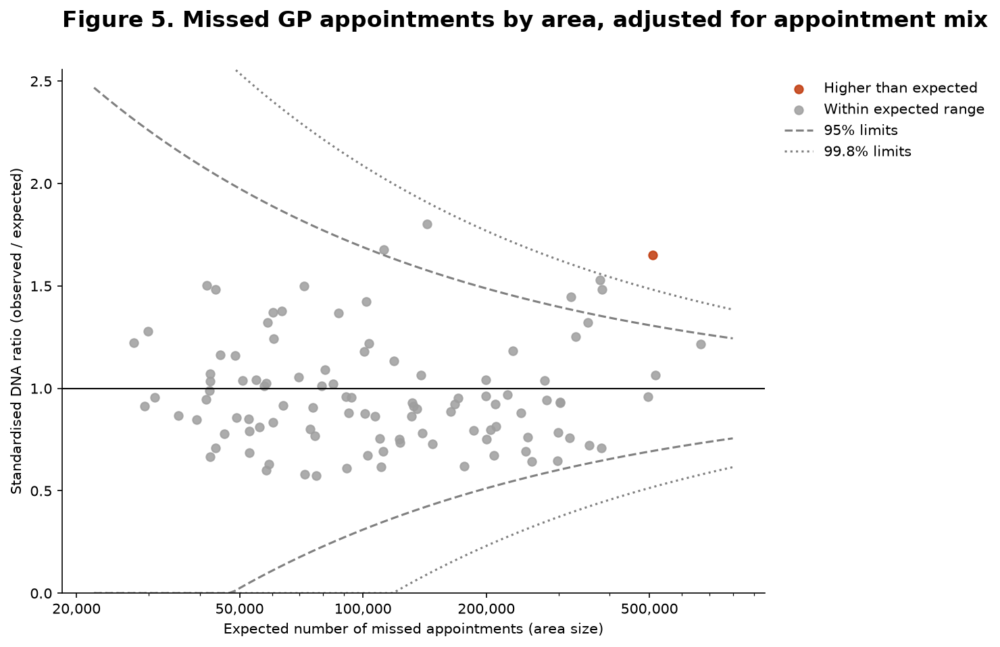

# Missed GP Appointments in England

**What makes patients more likely to miss a GP appointment? An analysis of 1.9 billion routinely collected NHS appointments.**

## Summary

Missed appointments ("did not attend", DNA) waste clinician time and delay care for other patients. I analysed NHS England's daily GP appointment data from **August 2020 to September 2026** to find which types of appointment are most often missed, how this has changed over time, and which areas have more missed appointments than expected.

From April 2022 onwards, **4.66% of 1.47 billion appointments were missed**, about 1 in 21. After adjusting for other factors:

- **When an appointment is booked matters most.** Appointments booked more than 28 days ahead had **3.9 times the odds** of being missed compared with same-day appointments.
- **Remote appointments were missed less often.** Telephone appointments had **37% lower odds** and video/online appointments **83% lower odds** than face-to-face appointments.
- **Appointments with other practice staff** (e.g. nurses) had **45% higher odds** of being missed than GP appointments.
- **Day of the week made almost no difference.**
- Missed appointments **fell slightly over time** (1.2% lower odds per year) and were most common in **December**.
- After adjusting for appointment mix, **one of 106 areas** had significantly more missed appointments than expected.

The full write-up is in **[REPORT.md](REPORT.md)**, and all code is in **[NHS_Appointments.ipynb](NHS_Appointments.ipynb)**.

## Data

| | |
|---|---|
| Source | NHS England, [*Appointments in General Practice*](https://digital.nhs.uk/data-and-information/publications/statistical/appointments-in-general-practice), daily counts by Sub-ICB location |
| Period | 1 August 2020 – 30 September 2026 (74 monthly files, 2,252 days) |
| Size | 22.8 million rows, 2.14 billion appointments |
| Licence | Contains public sector information licensed under the Open Government Licence v3.0 |

Each row in the data is a **count** of appointments sharing the same area, date, attendance status, mode, staff type and booking lead time, so all totals, rates and models are weighted by the count.

### How to get the data

The raw data is not included in this repository because of its size (about 3 GB).

1. Go to the NHS England publication page: [Appointments in General Practice](https://digital.nhs.uk/data-and-information/publications/statistical/appointments-in-general-practice).
2. Open a monthly release and download the daily counts zip file (*"Appointments recorded in GP practice appointment systems: Daily counts"*).
3. Unzip the CSV files (named like `SUB_ICB_LOCATION_CSV_Oct_25.csv`) into a folder called `data/` next to the notebook.

The notebook combines all files in `data/`, keeping each date once from the newest release.

## Methods

| Step | Method | Why |
|---|---|---|
| 1 | Combine 74 monthly files, keeping each date once from the newest release | Releases overlap and later releases revise earlier counts |
| 2–4 | Data checks, exclusions with a log, aggregation | 90.1% of appointments were analysable; every exclusion is counted |
| 5 | DNA rates with 95% Wilson confidence intervals | Describe how often appointments are missed, by factor |
| 6 | Binomial logistic regression on grouped counts, with cluster-robust standard errors by area | Estimate each factor's effect while adjusting for the others; areas are not independent |
| 7 | Overdispersion check, quasi-binomial comparison, sensitivity analyses | Check that conclusions do not depend on modelling choices |
| 8 | Trend and month-of-year terms in the model | Change over time and seasonality |
| 9 | Indirect standardisation and an overdispersion-adjusted funnel plot | Compare areas fairly, allowing for appointment mix and size |

## Figures

| | |
|---|---|
|  |  |
|  |  |

## Repository contents

| File | Contents |
|---|---|
| `NHS_Appointments.ipynb` | Full analysis, step by step, with explanations |
| `REPORT.md` | Written report: background, methods, results, discussion, limitations |
| `results/` | All tables (CSV) and figures (PNG) |
| `requirements.txt` | Python packages used |

## How to run

1. Download the data as described in [How to get the data](#how-to-get-the-data) and unzip the CSV files into `data/`.
2. Install the packages: `pip install -r requirements.txt`
3. Open `NHS_Appointments.ipynb` and run the cells in order. The combining step only needs to run once; it saves `data_combined.csv.gz` for later runs.

**Tools:** Python (pandas, NumPy, statsmodels, matplotlib)

## Author

Marina Gorikova
