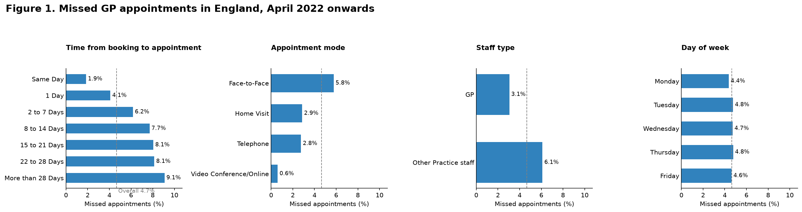
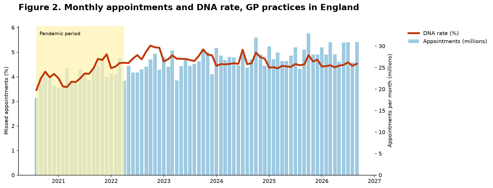
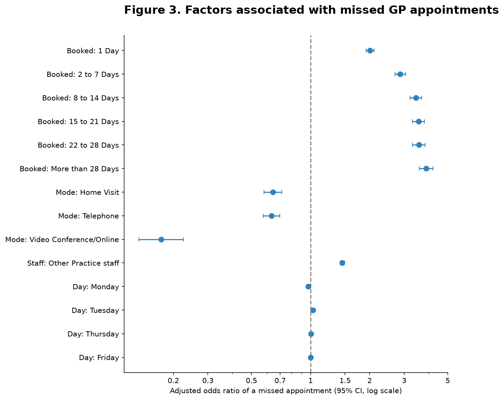
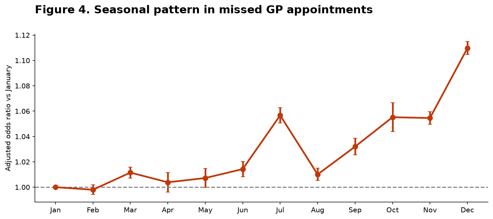
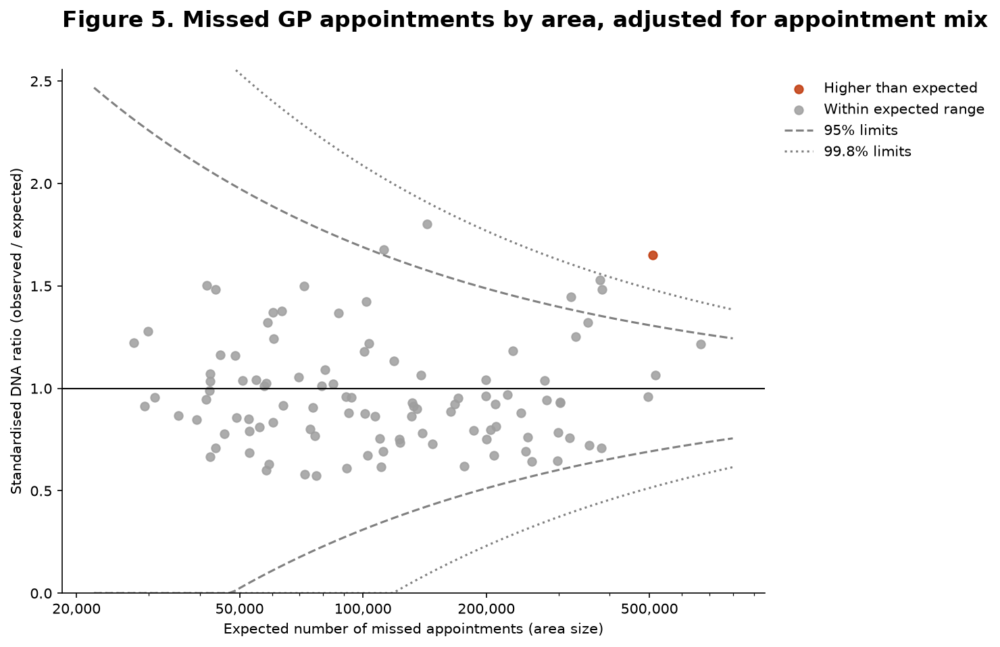

# Missed GP Appointments in England: Report

**Author:** Marina Gorikova
**Data:** NHS England, *Appointments in General Practice*, August 2020 – September 2026
**Code:** [NHS_Appointments.ipynb](NHS_Appointments.ipynb)

---

## 1. Summary

About **1 in 21 GP appointments in England (4.66%) was missed** between April 2022 and September 2026. The strongest factor was **booking lead time**: after adjusting for appointment mode, staff type and day of the week, appointments booked more than 28 days ahead had **3.9 times the odds** of being missed compared with same-day appointments. Telephone and video/online appointments were missed less often than face-to-face appointments, and appointments with other practice staff were missed more often than GP appointments. Missed appointments fell slightly over time and peaked in December. After adjusting for appointment mix, one of 106 areas had significantly more missed appointments than expected.

---

## 2. Background and question

Missed appointments ("did not attend", DNA) waste clinician time, lengthen waiting times and may delay care for the patients who miss them. Understanding which appointments are most often missed helps services target reminders and design booking systems.

**Questions:**
1. Which appointment characteristics are associated with a higher rate of missed GP appointments?
2. How has this changed over time, and is there a seasonal pattern?
3. Which areas have more missed appointments than expected, given their mix of appointments?

---

## 3. Data

**Source:** NHS England, [*Appointments in General Practice*](https://digital.nhs.uk/data-and-information/publications/statistical/appointments-in-general-practice), daily counts by Sub-ICB location. Contains public sector information licensed under the Open Government Licence v3.0.

**Design:** cross-sectional and trend analysis of routinely collected administrative health service data.

Each row of the data is a **count** of appointments that share the same area, date, attendance status (attended, DNA or unknown), appointment mode, staff type and time between booking and appointment. All totals, rates and models were therefore weighted by the count.

### 3.1 Combining the files

The data was published as monthly files. Later releases repeat earlier dates and can revise their counts, so simply stacking the files would double-count appointments. The files were combined using these rules:

- repeated files (same name or identical contents) were used once; one file without a month and year in its name was skipped
- each date was kept **once, from the newest release**

| | |
|---|---|
| Files used | 74 |
| Period | 1 August 2020 – 30 September 2026 |
| Rows | 22,810,759 |
| Appointments | 2,142,387,638 |
| Missing dates | 0 |
| Repeated rows | 0 |

### 3.2 Exclusions

| Excluded | Appointments | % of all |
|---|---|---|
| Attendance status unknown | 112,349,513 | 5.24 |
| Booking lead time unknown | 1,361,314 | 0.06 |
| Appointment mode unknown | 47,042,297 | 2.20 |
| Staff type unknown | 16,845,225 | 0.79 |
| Weekend appointments | 33,575,281 | 1.57 |
| **Analysed** | **1,931,214,008** | **90.14** |

The data was then aggregated to one row per area × month × weekday × mode × staff type × lead time (1.87 million rows), holding the number of missed and attended appointments.

**Pandemic period:** GP services changed substantially during COVID-19, so appointments up to March 2022 were analysed separately. The main analysis uses **April 2022 – September 2026** (1,470,186,599 appointments).

---

## 4. Methods

| Method | Purpose |
|---|---|
| DNA rate = missed ÷ (missed + attended), with 95% Wilson confidence intervals | Describe how often appointments were missed |
| Binomial logistic regression on grouped counts | Estimate the effect of each factor while adjusting for the others, as odds ratios (OR) |
| Cluster-robust standard errors by area | Appointments in the same area are not independent; this gives honest confidence intervals |
| Unadjusted vs adjusted odds ratios | Identify confounding |
| Overdispersion check (Pearson χ² / df) and quasi-binomial comparison | Check whether the model's assumptions about variation hold |
| Sensitivity analyses | Check robustness to excluding areas and to the pandemic period |
| Trend (years since April 2022) and month-of-year terms | Change over time and seasonality |
| Indirect standardisation and funnel plot with overdispersion-adjusted limits (Spiegelhalter, 2005) | Compare areas fairly, allowing for their appointment mix and size |

Reference groups: same-day booking, face-to-face, GP, Wednesday.

With over a billion appointments, almost every difference is statistically significant, so results are interpreted by the **size** of the effect and its confidence interval rather than by p-values.

---

## 5. Results

### 5.1 DNA rates (April 2022 onwards)

Overall, **4.66%** of appointments were missed (95% CI 4.65–4.66%).

| Factor | Group | DNA rate (%) |
|---|---|---|
| Time from booking | Same day | 1.85 |
| | 1 day | 4.09 |
| | 2–7 days | 6.18 |
| | 8–14 days | 7.71 |
| | 15–21 days | 8.06 |
| | 22–28 days | 8.14 |
| | More than 28 days | 9.09 |
| Mode | Face-to-face | 5.77 |
| | Home visit | 2.86 |
| | Telephone | 2.76 |
| | Video / online | 0.60 |
| Staff type | GP | 3.05 |
| | Other practice staff | 6.10 |
| Day of week | Monday – Friday | 4.38 – 4.78 |

### 5.2 Adjusted odds ratios

| Factor (vs reference) | OR unadjusted | OR adjusted (95% CI) | Change after adjustment |
|---|---|---|---|
| Booked 1 day ahead (vs same day) | 2.26 | **2.01** (1.92–2.11) | −11% |
| Booked 2–7 days | 3.49 | **2.86** (2.69–3.04) | −18% |
| Booked 8–14 days | 4.42 | **3.44** (3.21–3.68) | −22% |
| Booked 15–21 days | 4.64 | **3.55** (3.31–3.81) | −24% |
| Booked 22–28 days | 4.69 | **3.56** (3.31–3.83) | −24% |
| Booked more than 28 days | 5.29 | **3.89** (3.58–4.21) | −27% |
| Home visit (vs face-to-face) | 0.48 | **0.64** (0.58–0.71) | +34% |
| Telephone | 0.46 | **0.63** (0.58–0.70) | +37% |
| Video / online | 0.10 | **0.17** (0.13–0.22) | +75% |
| Other practice staff (vs GP) | 2.06 | **1.45** (1.41–1.49) | −30% |
| Monday (vs Wednesday) | 0.92 | **0.97** (0.95–1.00) | +6% |
| Tuesday | 1.01 | **1.03** (1.02–1.04) | +2% |
| Thursday | 1.01 | **1.01** (1.00–1.01) | 0% |
| Friday | 0.98 | **1.00** (1.00–1.01) | +2% |

**Confounding.** Adjustment changed several odds ratios noticeably. The effect of staff type fell from 2.06 to 1.45: appointments with other practice staff are more often booked in advance and held face-to-face. The lower odds for remote appointments moved towards 1 because remote appointments are more often booked for the same day. The lead-time effects fell by 11–27% but remained large.

### 5.3 Model checks

**Overdispersion:** the Pearson χ²/df was **454.6**, far above 1, so standard confidence intervals would be much too narrow. For example, the interval width for next-day booking was 0.004 with standard errors but 0.19 with cluster-robust errors. The main conclusions hold under the most cautious intervals.

**Sensitivity analyses:**
- All 107 areas had overall DNA rates between 1% and 15%, so no area was excluded as implausible.
- **Pandemic period (to March 2022):** the lead-time effect was very similar (OR 4.23 for more than 28 days ahead, vs 3.89 after the pandemic). Video/online appointments were much less protective during the pandemic (OR 0.82 vs 0.17), and the staff-type effect was stronger (OR 1.76 vs 1.45).

### 5.4 Trend and seasonality

After adjustment, the odds of a missed appointment **fell by 1.2% per year** (OR 0.988 per year, 95% CI 0.982–0.994).

Compared with January, missed appointments were most common in **December** (OR 1.11, 95% CI 1.10–1.11), **July** (OR 1.06) and **October–November** (OR 1.05–1.06). These seasonal effects are modest compared with the effect of booking lead time.

### 5.5 Comparing areas (October 2025 – September 2026)

After adjusting for each area's appointment mix, **105 of 106 areas** had DNA rates consistent with chance variation. **NHS North East London ICB (A3A8R)** had **65% more missed appointments than expected** (observed/expected ratio 1.65; 12.0 million appointments). No area was significantly lower than expected.

NHS Greater Manchester ICB (14L) had a higher ratio (1.80) but was within the expected range, because it is smaller (3.4 million appointments) and its estimate is less precise. Variation between areas was very large (overdispersion factor φ = 12,386), so the funnel limits were widened accordingly.

---

## 6. Discussion

**Booking lead time was the strongest and most consistent factor.** The longer the gap between booking and appointment, the more likely the appointment was missed, before and after the pandemic. Plausible explanations include patients forgetting, their health problem resolving, or their circumstances changing. This suggests that **reminders should target appointments booked well in advance**.

**Remote appointments were missed less often**, even after adjusting for lead time. Video/online appointments had the lowest odds after the pandemic, but not during it, which suggests their role changed as they became established.

**Appointments with other practice staff** were missed more often than GP appointments. Part of this is explained by their being booked further ahead, but a substantial difference remained after adjustment. One possible explanation is that these appointments are more often routine or preventive (e.g. reviews, vaccinations), which patients may see as less urgent; the data cannot confirm this.

**Area comparison:** most of the apparent differences between areas disappeared once appointment mix and chance variation were taken into account, showing why fair comparison methods matter. One area stood out and could be prioritised for review of booking and reminder practices.

### Possible uses
- Prioritise reminder systems for appointments booked more than a week ahead
- Offer remote appointments where clinically appropriate
- Review booking and reminder practices in areas above the funnel limits
- Plan for higher missed-appointment rates in December

---

## 7. Limitations

- **Aggregated data:** the results describe patterns across appointments, not individual patients. Patient characteristics (age, deprivation, health conditions) were not available, so they could not be adjusted for.
- **Unknown attendance status (5.2%)** was excluded; if these appointments differ from others, the DNA rate could be biased.
- **Recording practices vary** between GP practices and appointment systems.
- **Association, not causation:** appointments booked far ahead may differ in type or urgency. A randomised trial of reminders would provide stronger evidence.
- **Area codes and boundaries changed** during 2020–2026, so area comparisons used the last 12 months only.
- **English data**, which may not transfer directly to Australian health services.

---

## 8. Relevance to NSW

Missed appointments also affect NSW outpatient and community health services. The methods used here — rates with confidence intervals, adjusted logistic regression, handling overdispersion and clustering, sensitivity analyses, and standardised comparisons using funnel plots — are standard tools for analysing routinely collected health data and for comparing services fairly, as NSW Health and the Bureau of Health Information do for hospitals and Local Health Districts.

---

## 9. Conclusion

Using 1.47 billion routinely collected GP appointments, this analysis found that **when an appointment is booked matters far more than the day or month it falls on**. Appointments booked more than four weeks ahead had almost four times the odds of being missed. Targeting reminders at appointments booked well in advance, and offering remote appointments where suitable, could reduce missed appointments.

---

## Reference

Spiegelhalter DJ. Funnel plots for comparing institutional performance. *Statistics in Medicine*. 2005;24(8):1185–1202.
